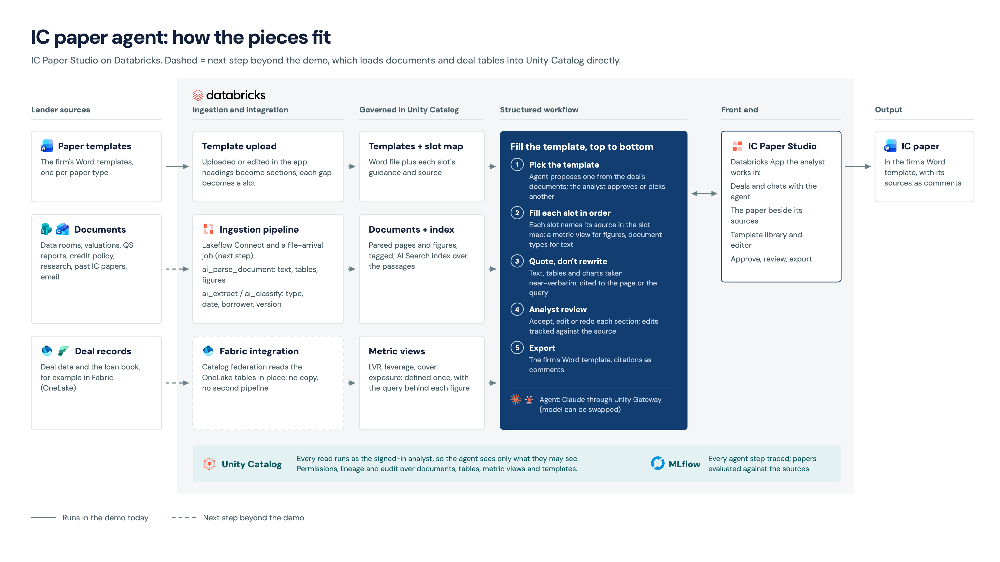

# IC Paper Studio

An agent that drafts investment committee credit papers into a lender's own Word templates. It works the way a credit
analyst does: it finds what it needs across the firm's document library, picks the paper that fits what is being asked,
and fills the template section by section in the sources' own words, with tables and charts carried across from the
source documents. Every point links back to the page or governed figure it came from, the analyst reviews and edits each
section, and the paper exports to Word with its sources as comments.

Everything runs on synthetic data: a fictional lender (Quillwood Credit Partners), six deals and a library of 138
documents (data rooms, valuations, credit policy, research, past IC papers and minutes, internal email), with deliberate
traps such as superseded drafts, last year's credit policy and look-alike borrowers.



## Deploy

You need the [Databricks CLI](https://docs.databricks.com/dev-tools/cli/install.html) (v1.17 or later), logged in to
your workspace, and a Unity Catalog catalog you can create a schema in. From a clone of this repo, run:

```bash
databricks bundle deploy --var catalog=<your_catalog> && databricks bundle run setup
```

- **`bundle deploy`** takes about five minutes. It creates a serverless SQL warehouse, the AI Search endpoint, the MLflow
  experiment and the setup job, then deploys and starts the app.
- **`bundle run setup`** builds the data in about 45 minutes, most of it parsing the PDFs. It uploads the document library and the deal tables, parses every PDF with
  `ai_parse_document`, classifies and extracts each document's facts with AI Functions, builds the AI Search index, links
  the experiment's traces to the schema, grants the app what it needs and restarts it. It prints a link to the job run.

When it finishes, open the app from **Compute > Apps** (or `databricks bundle summary`) and accept the consent prompt:
the app reads documents and tables as the signed-in user.

Add `-p <profile>` to both commands to use a CLI profile other than `DEFAULT`. Other variables, with their defaults:
`schema` (`ic_paper_studio`), `app_name` (`ic-paper-studio`) and `search_endpoint` (`ic-paper-search`). If you deploy
again, pass the same values.

### Workspace requirements

- Unity Catalog, serverless jobs and serverless SQL warehouses, Databricks Apps
- AI Functions: `ai_parse_document`, `ai_classify` and `ai_extract`
- AI Search, with the `databricks-gte-large-en` embedding endpoint
- Foundation Model APIs through Unity AI Gateway: `databricks-claude-sonnet-5-5`, `databricks-claude-opus-5-5`,
  `databricks-gpt-5-5` and `databricks-gpt-5-4` (edit `resources/app.yml` to use others)
- MLflow traces stored in Unity Catalog

Use a dedicated schema: the setup job creates tables and volumes in it.

## Try it

1. Open a deal in the sidebar and start a chat in **Ask before decisions** mode: "Prepare the credit paper for this deal".
2. The agent reads the deal's documents and proposes a template (screening, full IC or variation) with its reason.
   Approve it, decline it or pick another, then watch the paper fill.
3. Hover any citation number for the page excerpt with the quoted lines highlighted, or a governed figure for its metric
   view and query. **N to review** steps through the sections: accept, edit or ask the agent to redo one.
4. **Word** shows the filled template; **Export .docx** downloads it with every citation as a Word comment.
5. **Templates**: edit a copy of a template (remove sections, rename, change each slot's guidance and source) or upload an
   existing Word template. The agent can pick it straight away.

## What is in the repo

| Path | What it is |
|---|---|
| `app/` | The Databricks App: FastAPI backend, the agent (Claude Agent SDK, Codex or Pi on [Omnigent](https://github.com/omnigent-ai/omnigent), run inside the app), Word filling, template editor, built UI in `static/dist` |
| `ui/` | React source of the UI (`npm install && npm run build` writes `app/static/dist`) |
| `setup/` | The setup job's steps, in order: `01_workspace`, `02_parse`, `03_elements`, `05_enrich`, `06_index`, `07_traces`, `04_grants` |
| `content/library/` | The synthetic document library (PDFs); `manifest.json` is evaluation ground truth only and is never ingested |
| `content/structured/` | Deal, facility, covenant, drawdown, cash-flow and loan-book tables, and the metric view definitions |
| `eval/evaluate_paper.py` | Scores a drafted paper with MLflow evaluation: quotes still on the page, groundedness, share of source wording, and whether retrieval used the right documents and avoided the traps |
| `resources/` | The bundle: warehouse, AI Search endpoint, experiment, app and setup job |

## How it works

- **Sources** live in Unity Catalog: PDFs in a volume, parsed into page elements with their positions (so citations can
  highlight the lines), tagged with type, author, date, version and borrower, and indexed in AI Search for hybrid,
  reranked retrieval. Deal figures come from Unity Catalog metric views, so a number in the paper is the same governed
  number everywhere.
- **Reads run as the analyst**: the index returns passage ids, and the text is read from the governed tables with the
  signed-in user's permissions, so row filters and column masks apply to the agent too.
- **Near-verbatim by construction**: the fill tools reject a quote that is not on its page, mark the agent's own linking
  words, and track analyst edits against the source.
- **Approval modes per chat**: ask before decisions (template choice, adding files), auto-approve, or read only.
- **Traces**: every agent turn is an MLflow trace stored in the demo schema.
